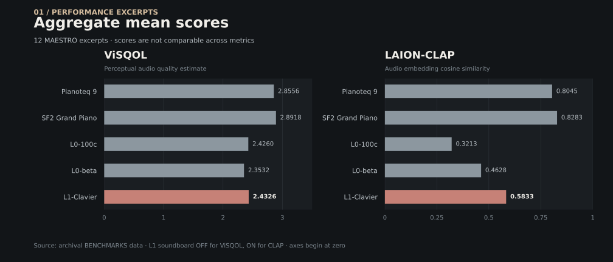
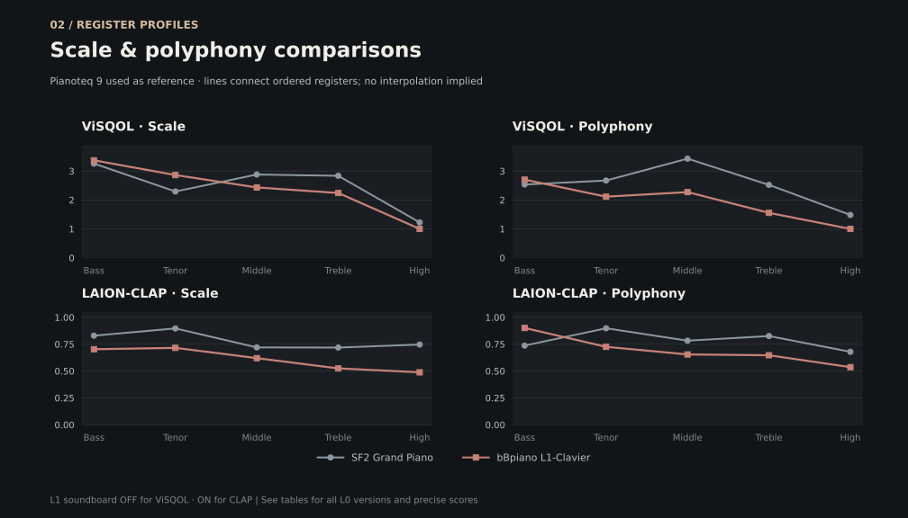

# bBpiano — Benchmarks & Acoustic Evaluation

*Archival research record · ViSQOL / LAION-CLAP · L0 / L1 series*

This report documents measured audio-similarity scores from earlier bBpiano development stages. It preserves the original per-piece observations, recalculates summary statistics directly from those observations, and distinguishes the limits of each metric. It does **not** present CPU throughput or real-time performance measurements.

本文整理 bBpiano 早期研发阶段的音频相似性评测数据，完整保留逐曲目记录，重新核算汇总统计，并明确各项指标的适用边界。**本文不包含 CPU 吞吐量或实时计算性能的测量结果。**

**In this report / 内容导览**  
[Overview](#1-overview) · [Methods](#2-evaluation-methodology) · [Results](#3-aggregate-results) · [Observations](#4-observations--limitations) · [Reproducibility](#5-reproducibility--data) · [ViSQOL detail](#appendix-a--visqol-detailed-results) · [CLAP detail](#appendix-b--laion-clap-detailed-results)

---

## 1. Overview

The objective is to compare the behavior of several piano synthesis implementations on aligned audio material, and to identify where further research may be useful. **A higher score indicates stronger similarity to the chosen reference under that particular metric—not a definitive judgment of physical accuracy or musical quality.**

这些实验旨在比较不同钢琴合成实现对于参考材料的响应，并定位可能值得进一步研究的问题。**较高分数仅表示在特定评价方法下，与对应参考音频更加相似；不能据此直接判定物理精度或音乐品质的优劣。**

| Item | Scope |
| :-- | :-- |
| Evaluation methods | ViSQOL; LAION-CLAP cosine similarity |
| Test groups | Scale; Polyphony; Performance |
| Performance excerpts | 12 selections associated with MAESTRO |
| Scale & Polyphony reference | Pianoteq 9 |
| Performance reference | Yamaha Disklavier recordings from the MAESTRO dataset |
| Compared engines | Pianoteq 9 (Performance only); SF2 Grand Piano; bBpiano L0-100c; L0-beta; L1-Clavier |
| Data status | Historical experiments; no new measurements conducted for this document |

> **Configuration note / 配置说明**  
> The recorded L1-Clavier setting differs between metrics: **ViSQOL: `soundboard_active_ = false`; LAION-CLAP: `soundboard_active_ = true`.** These are distinct evaluation conditions, not a controlled A/B test of the soundboard.  
> 两类指标采用不同的 L1-Clavier 音板设置，因此不能将跨指标的差异解释为音板模块的因果效果。

## 2. Evaluation Methodology

### 2.1 Reference material

- **Scale** — scale passages covering bass through high treble. The original experiment focused on subsystems other than aliasing; the provided record does not document a dedicated aliasing-control protocol.  
  **音阶**——覆盖低音至极高音域；原始说明重点考察混叠之外的子系统，但未记录专门的混叠控制方案。
- **Polyphony** — chords across the same register ranges, intended to probe coupled behavior.  
  **复音**——跨音域和弦，重点观察多声部与系统耦合的响应。
- **Performance** — 12 musical excerpts evaluated against recorded Yamaha Disklavier references associated with MAESTRO.  
  **演奏**——12 段音乐片段，以 MAESTRO 中 Yamaha Disklavier 的录音为参考。

Pianoteq 9 serves as the **reference**, rather than as a separate scored engine, for the Scale and Polyphony groups. It appears as a scored comparison engine for Performance. The underlying source does not provide the exact MAESTRO filenames, MIDI identifiers, or excerpt boundaries.

在音阶与复音测试中，Pianoteq 9 是**参考信号**，因此不作为独立的评分列；在演奏测试中，它则参与评分比较。原始记录未提供完整的 MAESTRO 文件名、MIDI 标识及截取范围。

### 2.2 Metrics

**ViSQOL** estimates full-reference perceptual audio quality using comparisons of audio signal representations. Its values here should be read as *similarity estimates under the documented experimental setup*, rather than a universal measure of instrument realism.

**ViSQOL** 使用参考音频与待测音频的信号表征进行比较，以估计感知音频质量。其分数只能在对应实验条件下解读，不能视为普适的钢琴真实感尺度。

**LAION-CLAP** produces learned audio embeddings; the reported statistic is **cosine similarity** between embeddings. It captures a different notion of similarity from ViSQOL, and does not directly measure compliance with acoustic governing equations or physical-model accuracy.

**LAION-CLAP** 基于学习得到的音频嵌入表征计算**余弦相似度**。它与 ViSQOL 衡量的相似性不同，也不能直接检验模型是否满足声学物理规律。

> The two metrics use **different numerical scales**. Their scores must not be added, averaged together, or compared as if they shared a common unit.  
> 两项指标的数值尺度不同，不应相加、混合求均值或直接比较绝对大小。

## 3. Aggregate Results

All aggregate statistics in this section refer **only to the 12 Performance excerpts**. The arithmetic mean, minimum, and maximum are recomputed from the individual values in Appendices A and B. Values are rounded to four decimal places; the detailed tables and accompanying CSV preserve the original supplied precision.

本节统计量**仅基于 12 段演奏测试**，由附录中的逐曲目数值重新计算。下表保留四位小数；附录与 CSV 保留原始记录的数值精度。

*Figure 1. Performance-group mean scores (n = 12). ViSQOL and CLAP use distinct axes and the L1-Clavier conditions differ between metrics. / 图 1：演奏组均值；两项指标分别使用独立坐标轴，且 L1 配置不同。*

### 3.1 ViSQOL · Performance (n = 12)

| Engine | Mean | Min | Max |
| :-- | --: | --: | --: |
| Pianoteq 9 | 2.8556 | 2.6867 | 2.9671 |
| SF2 Grand Piano | 2.8918 | 2.5331 | 3.0924 |
| bBpiano L0-100c | 2.4260 | 2.0482 | 2.6995 |
| bBpiano L0-beta | 2.3532 | 2.2183 | 2.4932 |
| **bBpiano L1-Clavier** | 2.4326 | 2.2403 | 2.5810 |

### 3.2 LAION-CLAP · Performance (n = 12)

| Engine | Mean | Min | Max |
| :-- | --: | --: | --: |
| Pianoteq 9 | 0.8045 | 0.6436 | 0.9413 |
| SF2 Grand Piano | 0.8283 | 0.7059 | 0.8852 |
| bBpiano L0-100c | 0.3213 | 0.1505 | 0.5253 |
| bBpiano L0-beta | 0.4628 | 0.1436 | 0.6226 |
| **bBpiano L1-Clavier** | 0.5833 | 0.3961 | 0.7419 |

### 3.3 Register profiles · Scale & Polyphony

*Figure 2. Register-wise Scale and Polyphony measurements for SF2 and L1-Clavier. The connected points represent ordered categories, not a continuously sampled frequency response. Complete L0 series appear in the appendix. / 图 2：SF2 与 L1 的分音区音阶、复音测试；折线仅连接有序音域类别，并非连续频响曲线。*

## 4. Observations & Limitations

**What the recorded results show / 已记录的现象**

- On the 12 Performance excerpts, L1-Clavier has a ViSQOL mean of **2.4326** and a CLAP mean of **0.5833**. These arise from *different soundboard configurations*.  
  在 12 段演奏中，L1-Clavier 的 ViSQOL 与 CLAP 均值分别为上述数值，但对应不同的音板设置。
- Relative to **L0-beta**, L0-100c scores **+0.0728** higher on mean ViSQOL, but **-0.1416** on mean CLAP for the Performance group. The metrics are not interchangeable.  
  与 L0-beta 相比，L0-100c 在演奏组的 ViSQOL 均值较高，而 CLAP 均值较低；二者并非同一种评价尺度。
- In the ViSQOL Scale and Polyphony tests, **L1-Clavier scores 1.000000000 in both High Treble rows**. This warrants further investigation of the rendering, alignment, measurement and/or score-floor behavior; the present record does not establish a cause.  
  在 ViSQOL 的极高音域音阶与和弦测试中，L1 均记录为 1.000000000；需要进一步检查合成、对齐或评分下限等因素，目前不能据此确定原因。
- In the CLAP Polyphony **Bass_chords** row, L1-Clavier scores **0.901042461**, above SF2 Grand Piano's **0.737208426** for that specific test. This is a local result, not an overall ranking.  
  在 CLAP 的低音和弦测试中，L1 分数高于 SF2，但这只说明该项局部结果，不能外推为整体优劣。

**Interpretation boundaries / 解释边界**

- The excerpts do not establish population-level or listener-tested superiority. No confidence intervals, independent listening-study outcomes, or repeated-measurement distributions are supplied.
- The original notes report CLAP score variation of approximately **5–10%** across repeated evaluations, with occasional deviations over **30%**. Without logs, seeds, checkpoint identifiers, and preprocessing records, these remain **project observations**, not a characterized intrinsic variance of the CLAP model.
- ViSQOL and CLAP scores are **not** measurements of real-time DSP throughput, latency, CPU load, memory use, or stability under polyphonic stress.
- The effect of enabling the L1 soundboard cannot be inferred causally from a comparison between two different metrics or their aggregate means.

这些测试并未构成独立听感实验，也未提供置信区间或完整的重复测量分布。CLAP 的波动幅度来自原始项目记录，尚不能据此认定模型固有的统计方差。本报告亦不能用于推断 CPU 负载、延迟或复音压力下的实时稳定性。

## 5. Reproducibility & Data

The original notes identify the reference family, excerpt count, metric names, and L1 soundboard switches. They do **not** specify every parameter needed for an independently reproducible run. The following information should be recorded in subsequent evaluations rather than inferred retrospectively.

原始资料提供了参考数据集、片段数量、指标名称及 L1 音板设置，但不足以完整复现实验。后续测试宜补充以下信息，不应对旧数据进行事后猜测。

| Item | Status in archival record |
| :-- | :-- |
| Dataset family | MAESTRO / Yamaha Disklavier noted |
| Exact excerpt IDs, MIDI files & boundaries | Not specified |
| bBpiano commit IDs / binary build identifiers | Not specified |
| ViSQOL implementation/version/model, input settings | Not specified |
| LAION-CLAP checkpoint/version/seed | Not specified |
| Sample rate, channel mapping, normalization, alignment | Alignment claimed for ViSQOL; detailed procedure not specified |
| Repeat count & dispersion | CLAP variability described; raw repeat logs not supplied |
| L1 ViSQOL configuration | `soundboard_active_ = false` |
| L1 CLAP configuration | `soundboard_active_ = true` |

**Machine-readable records:** [`doc/benchmarks/data/scores.csv`](doc/benchmarks/data/scores.csv) — 200 metric scores, preserving the originally supplied numeric precision, grouped by metric, workload, excerpt and engine. The CSV reproduces the published scores; it is not a replacement for the missing audio files or evaluation scripts.

**Arithmetic correction / 汇总核对：** The previous archival ViSQOL Performance summary had three discrepancies relative to its own per-piece values: Pianoteq 9 mean **2.8466 → 2.8556**; Pianoteq 9 minimum **2.6779 → 2.6867**; SF2 Grand Piano mean **2.9008 → 2.8918**. This edition uses the recomputed values without changing the individual observations.

---

## Appendix A — ViSQOL Detailed Results

**Reference / 参考音频:** Scale and Polyphony → Pianoteq 9; Performance → Yamaha Disklavier (MAESTRO). **L1-Clavier soundboard: off.** Higher scores indicate greater estimated perceptual similarity under this metric. Bold entries indicate the highest value among *displayed scored engines in the same row*; the reference for Scale and Polyphony is not a scored column.

### A.1 Scale · 音阶

| Piece | SF2 Grand Piano | bBpiano L0-100c | bBpiano L0-beta | bBpiano L1-Clavier |
| :-- | --: | --: | --: | --: |
| Bass_scale | 3.258543816 | 2.279772871 | 2.494259218 | **3.371336762** |
| Tenor_scale | 2.294533822 | 1.005804746 | 1.864653641 | **2.862334516** |
| Middle_scale | **2.880688398** | 2.400253359 | 2.182012820 | 2.433165462 |
| Treble_scale | **2.836848379** | 2.216778580 | 1.898298445 | 2.241825189 |
| High Treble_scale | **1.224602593** | 1.047544827 | 1.093359043 | 1.000000000 |

### A.2 Polyphony · 复音

| Piece | SF2 Grand Piano | bBpiano L0-100c | bBpiano L0-beta | bBpiano L1-Clavier |
| :-- | --: | --: | --: | --: |
| Bass_chords | 2.534555915 | 2.077254981 | 2.166119601 | **2.702758894** |
| Tenor_chords | **2.672740293** | 2.514874952 | 1.876183765 | 2.114384760 |
| Middle_chords | **3.429775842** | 2.862829766 | 2.503931537 | 2.272731897 |
| Treble_chords | **2.521915846** | 1.859617369 | 1.935985753 | 1.554736190 |
| High Treble_chords | **1.482525693** | 1.222981887 | 1.139869631 | 1.000000000 |

### A.3 Performance · 演奏

| Piece | Pianoteq 9 | SF2 Grand Piano | bBpiano L0-100c | bBpiano L0-beta | bBpiano L1-Clavier |
| :-- | --: | --: | --: | --: | --: |
| Etude-Tableaux Op.39 No.5 | 2.9136 | **2.9863** | 2.6995 | 2.4852 | 2.567014830 |
| Images, Book II "Poissons d'or" | **2.8029** | 2.7804 | 2.5644 | 2.3634 | 2.360572665 |
| Piano Sonata "From the Street" | 2.9598 | **3.0255** | 2.4664 | 2.3462 | 2.580950304 |
| Prel. Chor. Fug. | 2.9266 | **3.0012** | 2.5196 | 2.2769 | 2.557200327 |
| Prelude and Fugue in A Minor, S.462/1 | 2.9671 | **3.0924** | 2.5948 | 2.4029 | 2.378045542 |
| Prelude and Fugue in D Major, BWV 874 | **2.7859** | 2.6779 | 2.2438 | 2.2183 | 2.547757825 |
| Sonata No.28 Op.101 | 2.8137 | **2.8996** | 2.3586 | 2.3095 | 2.472213729 |
| Sonata No.4 Op.30 | 2.7626 | **2.8409** | 2.4185 | 2.2881 | 2.321314186 |
| Sonata in B Minor | **2.8854** | 2.8354 | 2.3827 | 2.2733 | 2.428109815 |
| Sonata in D Major K.576 | 2.8285 | **3.0614** | 2.0482 | 2.4669 | 2.249377555 |
| Sonata in D Minor K.141 | **2.6867** | 2.5331 | 2.2945 | 2.4932 | 2.240295448 |
| Sonata in F Minor Op.5 | 2.9342 | **2.9671** | 2.5207 | 2.3144 | 2.487915857 |

---

## Appendix B — LAION-CLAP Detailed Results

**Reference / 参考音频:** Scale and Polyphony → Pianoteq 9; Performance → Yamaha Disklavier (MAESTRO). **L1-Clavier soundboard: on.** Values are cosine similarities in the selected embedding space. Bold entries indicate the highest value among *displayed scored engines in the same row*.

### B.1 Scale · 音阶

| Piece | SF2 Grand Piano | bBpiano L0-100c | bBpiano L0-beta | bBpiano L1-Clavier |
| :-- | --: | --: | --: | --: |
| Bass_scale | **0.829674840** | 0.591492534 | 0.387630433 | 0.702944458 |
| Tenor_scale | **0.896856070** | 0.371731043 | 0.300049216 | 0.716075599 |
| Middle_scale | **0.720027626** | 0.233823359 | 0.168149158 | 0.619980037 |
| Treble_scale | **0.718633533** | 0.192326903 | 0.166393086 | 0.524722159 |
| High Treble_scale | **0.746628761** | 0.304847121 | 0.317520738 | 0.488264501 |

### B.2 Polyphony · 复音

| Piece | SF2 Grand Piano | bBpiano L0-100c | bBpiano L0-beta | bBpiano L1-Clavier |
| :-- | --: | --: | --: | --: |
| Bass_chords | 0.737208426 | 0.712322891 | 0.491204530 | **0.901042461** |
| Tenor_chords | **0.898284912** | 0.612981141 | 0.465305507 | 0.725399315 |
| Middle_chords | **0.782639027** | 0.344589412 | 0.309159577 | 0.654511511 |
| Treble_chords | **0.825937271** | 0.233994871 | 0.203228608 | 0.647006929 |
| High Treble_chords | **0.679073453** | 0.220188931 | 0.261892319 | 0.536056995 |

### B.3 Performance · 演奏

| Piece | Pianoteq 9 | SF2 Grand Piano | bBpiano L0-100c | bBpiano L0-beta | bBpiano L1-Clavier |
| :-- | --: | --: | --: | --: | --: |
| Etude-Tableaux Op.39 No.5 | 0.7640 | **0.8494** | 0.3476 | 0.5452 | 0.571054816 |
| Images, Book II "Poissons d'or" | **0.7816** | 0.7704 | 0.4385 | 0.4862 | 0.544904232 |
| Piano Sonata "From the Street" | **0.8993** | 0.8060 | 0.1505 | 0.5820 | 0.710870922 |
| Prel. Chor. Fug. | 0.7994 | **0.8852** | 0.4831 | 0.4735 | 0.741906404 |
| Prelude and Fugue in A Minor, S.462/1 | **0.9413** | 0.8776 | 0.5253 | 0.6226 | 0.509185374 |
| Prelude and Fugue in D Major, BWV 874 | 0.6436 | **0.8413** | 0.1691 | 0.4318 | 0.545421720 |
| Sonata No.28 Op.101 | 0.7851 | **0.8338** | 0.3241 | 0.4066 | 0.671635807 |
| Sonata No.4 Op.30 | 0.7962 | **0.8154** | 0.4225 | 0.5763 | 0.514670193 |
| Sonata in B Minor | **0.7088** | 0.7059 | 0.2329 | 0.5579 | 0.396069169 |
| Sonata in D Major K.576 | **0.8754** | 0.8503 | 0.2747 | 0.4318 | 0.608233094 |
| Sonata in D Minor K.141 | **0.8897** | 0.8641 | 0.2403 | 0.2966 | 0.544550717 |
| Sonata in F Minor Op.5 | 0.7701 | **0.8401** | 0.2468 | 0.1436 | 0.641184807 |

---

*Historical evaluation record · bBpiano / bBSonicLab. All rights to the software and its implementation remain governed by the applicable bBpiano license; this document does not amend that license.*
