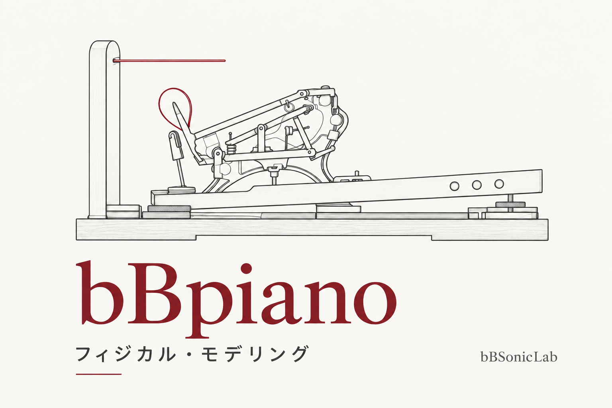
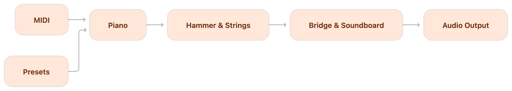
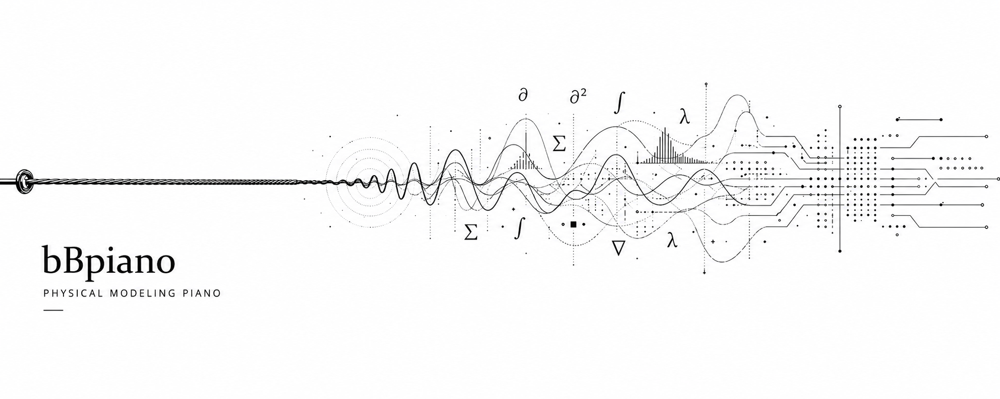

# bBpiano - bBSonicLab Physical Modeling



<hr>
<div align="center" style="line-height: 1;">
  <a href="https://github.com/opus-arc/bBpiano/actions/workflows/engine-evaluation.yml" target="_blank"></a>
  <br>   
  <a href="https://github.com/opus-arc/bBpiano/milestone/1" target="_blank"></a>
  <a href="https://github.com/opus-arc/bBpiano/milestone/1" target="_blank"></a>
  <br>
    <a href="https://opus-arc.github.io/bBpiano/"><b>Page</b>👁️</a>
</div>


> 私は、音楽などの芸術と数学などのサイエンスに共通して、それを深く理解し新たな価値を創造する上で最も大切なものは、「美」に対する感性だと考えています。
>
> 「美と真実だけを追求し、他は忘れろ」は、ジャズ・ピアノの巨匠ビル・エヴァンスが言ったとされる言葉です。
>
> 「楽器の科学的設計手法開発」を生業とする私の心にはいつもこの言葉があります。
>
> — **Eiji Tominaga（富永 英嗣）**, Yamaha Corporation


### α. Research Foundations & Acknowledgments

The development of bBpiano has benefited greatly from earlier research in piano acoustics, physical modeling, and sound synthesis.

In particular, I would like to acknowledge **Juliette Chabassier** and her collaborators for their rigorous studies of grand piano acoustics and the coupled dynamics of strings and soundboard; **Eiji Tominaga** for his experimental and theoretical investigations of piano hammer mechanics, as well as his generous guidance and insights; and **Balázs Bank** and his collaborators for their contributions to efficient physics-based piano synthesis, including digital waveguide modeling and modal synthesis.

I am also grateful to **Julien Bensa** and his collaborators for their research on frequency-dependent string losses and dispersion, and to **Niko Plath** for making his experimental measurements of piano vibration and acoustic radiation available to the research community.

Their work has provided invaluable theoretical foundations, experimental references, and new perspectives for this project. I am sincerely grateful for the care and dedication with which they have pursued a deeper understanding of the piano as a physical instrument.

#### Selected References

1. **Bank et al. (2000)** — [Efficient Physics-Based Sound Synthesis of the Piano Using DSP Methods](https://home.mit.bme.hu/~bank/publist/eusip00.pdf)
2. **Bensa et al. (2003)** — [The Simulation of Piano String Vibration: From Physical Models to Finite Difference Schemes and Digital Waveguides](https://doi.org/10.1121/1.1587146)
3. **Bank, Zambon & Fontana (2010)** — [A Modal-Based Real-Time Piano Synthesizer](https://doi.org/10.1109/TASL.2010.2040524)
4. **Chabassier, Chaigne & Joly (2013)** — [Modeling and Simulation of a Grand Piano](https://doi.org/10.1121/1.4809649)
5. **Plath (2019)** — [Influence of Playing on the Tonal Characteristics of a Concert Piano — Experimental Dataset](https://doi.org/10.5281/zenodo.3271370)
6. **Tominaga & Sato (2026)** — [Time-Domain Simulation using Component Mode Synthesis for a Piano](https://doi.org/10.21203/rs.3.rs-9307819/v1)


### **β. Development Status**

**Active Research & Development**

The project is currently undergoing extensive research and architectural refinement toward its next major release.

The latest public version remains available as a stable reference. Development is focused on improving physical modeling accuracy, numerical stability, and real-time performance.

Public updates may be less frequent during this period as experimental work continues privately.

Thank you for your patience and interest.


##     1. Introduction

bBpiano is a physical modeling piano synthesis project inspired by Pianoteq 9, currently in an active research and development stage. At its core is a physically modeled piano engine, designed to remain lightweight and responsive while capturing the immediacy, presence, and expressive vitality of a live instrument.

bBpiano是一个受Pianoteq 9启发的物理建模钢琴合成项目，目前处于积极的研发阶段。 其核心是一个物理建模的钢琴引擎，旨在保持轻巧和响应，同时捕捉现场乐器的即时性、存在感和表现力。

### **A Note from bBSonicLab**

It is neither the product of a large company nor the work of a dedicated acoustics institute. Much of it has been built through curiosity, experimentation, and countless attempts to understand problems that often seemed larger than the people studying them.

bBpiano 是一项独立开展的研究计划。我们将研究中逐渐成形的成果呈现于此，愿它们也能对他人有所助益。

It is neither the product of a large company nor the work of a dedicated acoustics institute. It began, rather simply, with curiosity, and has continued through experiments, repeated failures, and questions that remain difficult to answer.

它既非大型公司的产品，亦非出自专业的声学研究机构。最初，不过是出于一点好奇。此后，便是在实验、反复的失败，以及许多至今仍难以回答的问题中，一路走到了这里。

The project remains incomplete. Its models are imperfect, and our understanding of the piano is still limited. There is much that we have yet to learn.

项目尚未完成，模型亦有诸多不足。对于钢琴，我们所理解的仍然十分有限。还有许多事情，需要慢慢学习。

Nevertheless, we hope that something found along the way may have a life beyond this project.

尽管如此，我们仍希望，这一路上偶然寻得的某些东西，能够在项目之外，继续发挥一点作用。

If previous generations left behind instruments, scores, recordings, and performances, perhaps our generation can also leave behind something of its own — algorithms, models, experiments, and the quiet wish to understand why sound moves us.

如果过去的世代为我们留下了乐器、乐谱、录音与演奏，那么或许，我们这一代人也能够留下些什么属于自己的东西——算法、模型、实验，以及那份想要理解声音为何动人的、未曾消散的心愿。

This repository is one small shelter built around that pursuit.

这个仓库，便是围绕这份追寻搭起的一处小小庇护所。

There may be something of value here, and certainly many things that could have been done better. We leave this record as it is, with gratitude to those whose work has guided us, and with the quiet hope that it may one day be of use to someone we have never met.

这里或许有些值得留存的东西，也一定有许多本可以做得更好的地方。我们将这份记录留在此处，感谢一路上给予我们启发与指引的前人，也怀着一个朴素的愿望：愿它在未来的某一天，能够对某位素未谋面的人有所帮助。

— bBSonicLab


## 2. Project Philosophy

Many virtual pianos today rely on sample-based synthesis, reproducing the sound of an instrument through carefully recorded performances. Over decades of refinement, this approach has achieved remarkable realism and musical expressiveness. bBpiano explores a different direction.

Rather than reproducing the sounds an instrument has already made, we are interested in understanding how those sounds come into being.

A piano is not merely a collection of notes. Each sound arises from a complex interaction of forces, materials, vibrations, and time. We believe that, by studying these relationships carefully, it may be possible to reconstruct something of the instrument itself through mathematics and computation.

Our aim is not simply to reproduce a waveform, but to understand the physical processes from which it arises.

A recorded sound preserves a moment that has already passed. A physical model attempts something different: to describe the conditions under which sound may arise again. In this sense, we are not merely trying to remember the sound of a piano, but to understand how a piano speaks.

Whether such an understanding can ever become sufficiently complete is a question we cannot yet answer. Nevertheless, we hope that, through careful observation, mathematical reasoning, and repeated experimentation, the distance between the modeled instrument and the real one may gradually diminish.

Physical modeling offers certain possibilities that we find particularly compelling.

Instead of relying on extensive collections of recorded samples, an instrument can be described through a relatively compact set of mathematical relationships and physical parameters. Its response to an action is then calculated as it happens, allowing subtle variations in touch, vibration, and resonance to emerge from the interactions within the model.

More importantly, these relationships can be examined. When something does not sound quite right, we may return to the underlying physics, reconsider an assumption, or question whether our understanding of the instrument was sufficient in the first place.

Of course, this approach brings difficulties of its own. Greater physical detail does not necessarily lead to better sound, and a more accurate model is not always one that can be played in real time. Much of our work lies in finding a reasonable balance between physical fidelity, computational efficiency, and musical expression.

Our long-term goal is to bring these two pursuits together: to understand the acoustic piano as faithfully as we can, and to make that understanding practical enough to become a playable instrument.

A model may describe the behavior of a string or a soundboard with considerable accuracy, yet remain too demanding to run in real time. Conversely, an efficient instrument may be pleasant to play while still overlooking important aspects of the physics that give a real piano its character.

We do not believe that either physical accuracy or computational efficiency should be pursued entirely at the expense of the other. The difficulty, and perhaps much of the interest of this work, lies in finding a way for them to coexist.

If, one day, a musician can sit before such an instrument and simply play, without having to think about the mathematics taking place beneath their fingers, we would consider that a meaningful achievement.

There is, however, one question that remains beyond the measurements and calculations.

Even if we could describe every vibration with sufficient accuracy, would that mean we had understood everything that makes a piano a musical instrument?

We do not know.

Perhaps some things can only be understood through the act of listening, or through the experience of playing. Perhaps mathematics can bring us closer to them than we presently imagine.

For now, we would simply like to continue asking.

**Can the soul of an acoustic instrument be reconstructed through mathematics and computation alone?**

---

如今，许多虚拟钢琴采用基于采样的声音合成技术，通过精心录制的声音重现乐器的表现。经过数十年的发展与完善，这一技术路线已在声音真实感与音乐表现力方面取得了卓越的成果。

bBpiano 探索的是另一条道路。

比起重现一件乐器曾经发出的声音，我们更感兴趣的是：这些声音究竟如何产生。

钢琴并不只是一组音符的集合。每一个声音，都来自力、材料、振动与时间之间复杂的相互作用。我们相信，如果能够认真地理解这些关系，或许便有可能通过数学与计算，重构出这件乐器的某些本质。

我们的目的，并不只是复现一段波形，而是理解使它得以产生的物理过程。

录音保存的是一个已经过去的瞬间。而物理模型所尝试的，则是另一件事情：描述声音得以再次产生的条件。从这个意义上说，我们所追求的，不仅是记住钢琴的声音，更是理解钢琴如何发声。

这样的理解究竟能否趋于完整，目前我们还无法回答。尽管如此，我们仍希望通过细致的观察、数学推理与反复实验，使模型中的乐器与真实乐器之间的距离，逐渐缩小。

物理建模为我们提供了某些格外令人着迷的可能性。

一件乐器不再需要依靠大量录音样本来描述，而是可以由一组相对紧凑的数学关系与物理参数构成。它对演奏动作的响应，在声音产生的过程中被实时计算；触键、振动与共鸣之间那些细微的变化，也由模型内部的相互作用自然产生。

更重要的是，这些关系本身是可以被考察的。当某个声音不尽如人意时，我们可以重新回到它所依据的物理规律，检视某项假设，或是反思：我们对这件乐器的理解，是否从一开始便有所欠缺。

当然，这条道路也有其自身的困难。更丰富的物理细节未必意味着更好的声音，而更加精确的模型，也未必能够在实时演奏中运行。我们的大量工作，便是在物理保真度、计算效率与音乐表现力之间，寻找一种尽可能合理的平衡。

我们的长期目标，是尝试将这两种追求结合起来：一方面尽可能忠实地理解声学钢琴，另一方面，也让这样的理解能够真正成为一件可供演奏的乐器。

一个模型或许能够相当精确地描述琴弦与音板的行为，却因为计算量过于庞大而无法实时运行。反过来，一件运行高效、演奏舒适的乐器，也可能仍然忽略了真实钢琴之所以具有独特性格的某些重要物理机制。

我们并不认为，应当为了其中一方而完全牺牲另一方。如何让物理精度与计算效率得以共存，既是这项工作的困难所在，或许也是其中大部分趣味的来源。

如果有一天，一位演奏者能够坐在这样的乐器面前，自然而然地开始演奏，而不必在意指尖之下正在进行怎样的数学计算，我们便会认为，这是一件颇有意义的成果。

然而，在所有测量与计算之外，仍有一个问题始终萦绕于心。

即使有一天，我们能够足够精确地描述每一次振动，是否便意味着，我们已经理解了一架钢琴之所以成为乐器的一切？

我们还不知道。

或许，有些事情只能在聆听之中，或是在亲自演奏时得到理解。也或许，数学能够带领我们抵达比今日所能想象的更远的地方。

至少在当下，我们仍愿意继续追问。

**仅凭数学与计算，我们能否重构一件声学乐器的灵魂？**

## 3. bBpiano Technical Overview



## 4. Quick Start

### Installation

**macOS · Homebrew**

Install via [Homebrew](https://brew.sh/):

```bash
brew install opus-arc/tap/bBpiano-L
```

## 5. Evaluation Results

To evaluate the acoustic realism and synthesis quality of bBpiano, we compare synthesized audio against reference recordings from the MAESTRO Yamaha Disklavier dataset. Baseline systems include Pianoteq 8 (physical modeling) and a conventional SF2 sampled piano. Current evaluations focus on model efficiency, representation-level similarity, and perceptual audio quality.

为了评估 bBpiano 在声学真实感与合成质量方面的表现，我们将其合成音频与 MAESTRO 数据集中 Yamaha Disklavier 的真实演奏录音进行比较。基准系统包括 Pianoteq 8（物理建模）以及传统的 SF2 采样钢琴。目前的评估主要关注模型效率、表征层面的相似度以及感知音频质量。

In addition to the MAESTRO Yamaha Disklavier dataset, selected evaluations also incorporate recordings from the Iowa Electronic Music Studios (Iowa EMS) Steinway Model B dataset. Since the Iowa dataset provides isolated piano recordings rather than aligned MIDI performances, note events and velocity information are automatically estimated using a pretrained piano transcription model to construct a unified benchmarking sequence. This allows direct comparisons between bBpiano, physical-modeling instruments, and sample-based pianos under controlled and reproducible conditions.

除 MAESTRO Yamaha Disklavier 数据集之外，部分评估还引入了 Iowa Electronic Music Studios（Iowa EMS）所提供的 Steinway Model B 钢琴录音。由于 Iowa 数据集提供的是独立钢琴录音，而非与 MIDI 对齐的演奏数据，因此我们使用预训练的钢琴转录模型自动估计其中的音符事件与力度信息，并据此构建统一的基准测试序列。由此，bBpiano、其他物理建模乐器以及采样式钢琴得以在受控且可复现的条件下进行直接比较。

*Detailed test results and statistical data are included in the attachment.*

完整的测试结果与统计数据收录于项目附件中。

[Benchmarks & Acoustic Evaluation](./BENCHMARKS.md)

### Engine Overview

| Category | MAESTRO Dataset | Pianoteq 8 | SF2 (Grand Piano) | bBpiano L0-100c | **bBpiano L1-Clavier** |
|:----------|:----------:|:----------:|:----------:|:----------:|:----------:|
| Type | Reference Recording | Physical Modeling | Sample-Based | Physical Modeling | **Physical Modeling** |
| Size | 1–10 GB (test subset) | 380 KB | 36 MB | 1.1 MB | **281 KB** |
| Real-Time Synthesis | ❌ | **✅** | ❌ | **✅** | **✅** |
| Polyphony | N/A | **5 × 88** (M4) | N/A | 23.34 | **5.97 × 88** (M4, 2024) |


即使在 88 个琴键同时处于活动状态的测试中，L1-Clavier 在该 M4 平台上平均占用约 **16.75% 的实时计算预算**，对应约 **5.97 倍实时速度**。

The following L1-Clavier results are arithmetic means of **10 independent `bbpl -t` runs** on a 2024 Apple M4, Release build, at 44.1 kHz. Each run passed all four real-time checks.

下表为 2024 Apple M4 平台、44.1 kHz、Release 构建下 **10 次独立 `bbpl -t` 测试**的算术平均值；每次测试的四项实时检查均为 PASS。

| Range | Mean Frame | Frame Budget | Mean Occupancy | Mean Speed | Result |
|:------|-----------:|-------------:|---------------:|-----------:|:------:|
| High-range | 1.360 µs | 22.68 µs | 5.99% | 16.69× | PASS |
| Mid-range | 1.146 µs | 22.68 µs | 5.05% | 19.80× | PASS |
| Bass-range | 0.905 µs | 22.68 µs | 3.99% | 25.08× | PASS |
| 88 keys | 3.797 µs | 22.68 µs | 16.75% | 5.97× | PASS |

> [!NOTE]
>
> Engine-performance results are hardware- and compiler-dependent. These measurements were obtained from a Release build on a 2024 Apple M4 system and should primarily be interpreted as a reproducible reference for the current implementation rather than as a universal performance guarantee.
>
> 引擎性能会受到硬件、编译器与构建配置的影响。上述数据来自 2024 Apple M4 平台上的 Release 构建，因此主要用于记录当前实现的可复现性能基准，而不应被视作所有计算环境下的统一性能保证。

---

### VISQOL

VISQOL evaluates perceptual audio quality by estimating similarity between synthesized and reference recordings.

VISQOL 通过估计合成音频与参考录音之间的相似程度，对感知音频质量进行评估。

The Scale and Polyphony sections use Pianoteq 9 as the standard, while the standard reference recordings for the performance sections are taken from the Yamaha Disklavier subset in the MAESTRO dataset. Higher values indicate stronger perceptual similarity to the reference recordings.

Scale 与 Polyphony 部分以 Pianoteq 9 作为参考标准，而 Performance 部分的标准参考录音则取自 MAESTRO 数据集中的 Yamaha Disklavier 子集。数值越高，表示待测音频与参考录音在感知层面具有越高的相似度。

| Method | VISQOL Score |
|:---------|---------:|
| MAESTRO Yamaha Disklavier | Reference |
| Pianoteq 9 | 2.8466 |
| SF2 (Grand Piano) | **2.9008** |
| bBpiano L0-100c | 2.4260 |
| bBpiano L0-beta | 2.3532 |
| **bBpiano L1-Clavier** | **2.4326** |

| Method                     | VISQOL Score |
| :------------------------- | -----------: |
| Pianoteq 8                 |    Reference |
| **Tominaga et al. (2026)** |       3.0820 |

---

### LAION-CLAP

The Scale and Polyphony sections use Pianoteq 9 as the standard, while the standard reference recordings for the performance sections are taken from the Yamaha Disklavier subset in the MAESTRO dataset. Higher values indicate a stronger similarity in the CLAP embedding space.

Scale 与 Polyphony 部分以 Pianoteq 9 作为参考标准，而 Performance 部分的标准参考录音则取自 MAESTRO 数据集中的 Yamaha Disklavier 子集。数值越高，表示待测音频与参考录音在 CLAP 嵌入空间中具有越高的相似度。

I believe the values provided by LAION-CLAP reflect more of an overall impression—such as tone, style, and mood—rather than physical accuracy. bBpiano aims to create a model that closely resembles a real piano, but isn’t limited to that style.

我们认为，LAION-CLAP 所给出的数值更多反映的是一种整体性的听觉印象——例如音色、风格与情绪——而非物理层面的准确性。bBpiano 的目标是构建一个能够高度逼近真实钢琴的模型，但它所能够产生的声音与表达，并不应被局限于对真实钢琴的单纯模仿。

| Method | Cosine Similarity |
|:---------|---------:|
| Pianoteq 9 | 0.8045 |
| SF2 (Grand Piano) | **0.8283** |
| bBpiano L0-100c | 0.3213 |
| bBpiano L0-beta | 0.4628 |
| **bBpiano L1-Clavier** | **0.5833** |

| Method                     | **Cosine Similarity** |
| :------------------------- | --------------------: |
| Pianoteq 8                 |             Reference |
| **Tominaga et al. (2026)** |            **0.9293** |

---

### Historical Progress

| Category | Benchmark | bBpiano L0-alpha | bBpiano L0-beta | bBpiano L0-100c | **bBpiano L1-Clavier** |
|:---------|:---------|---------:|---------:|---------:|---------:|
| Engine | Binary Size | 1.04 MB | 1.04 MB | 1.1 MB | **281 KB** |
| Engine | Real-Time Synthesis | ✅ | ✅ | ✅ | **✅** |
| Engine | Polyphony | 5.21 | 11.27 | 23.34 | **5.97 × 88** |
| LAION-CLAP | Cosine Similarity (MAESTRO Reference) | - | 0.4628 | 0.3213 | **0.5833** |
| VISQOL | Mean (MAESTRO Reference) | - | 2.3532 | 2.4260 | **2.4326** |

## 6. License

bBpiano is distributed under the proprietary [bBpiano CLI Use and Extension License 1.2](https://github.com/opus-arc/bBpiano/blob/main/LICENSE).

The license permits ordinary personal, academic, and commercial use, including the unrestricted use and distribution of generated audio. Independent research and non-commercial extensions are welcome, while commercial integration and redistribution require prior authorization. The underlying implementations, algorithms, and model parameters remain proprietary.

bBpiano 采用专有的 [bBpiano CLI Use and Extension License 1.2](https://github.com/opus-arc/bBpiano/blob/main/LICENSE) 发布。

该许可允许正常的个人、学术及商业使用，包括自由使用与分发所生成的音频成果。我们欢迎独立研究与非商业扩展；商业集成及软件再分发则须事先获得授权。底层实现、算法及模型参数仍属于专有技术，受到保护。

## 7. Contact

For questions, feedback, or inquiries, you are welcome to open a GitHub issue or reach out via [Email](mailto:arcopus07@gmail.com) or [Instagram](https://www.instagram.com/arcopus07/).

如有任何问题、建议或交流意向，欢迎通过 GitHub Issue、[电子邮件](mailto:arcopus07@gmail.com)或 [Instagram](https://www.instagram.com/arcopus07/) 与我们联系。

---

Every resonance eventually fades.  
What remains is the desire to keep creating, to keep moving, and perhaps, one day, to become as free as the bluebird.

***Bluebird** comes from David Bowie's final farewell, **Lazarus**:*
*"Just like that bluebird, I'll be free."*

每一次共鸣最终都会消失。

剩下的是继续创造的愿望，继续前进，也许有一天，会像蓝鸟一样自由。

bB 来自大卫·鲍伊最后的告别，**Lazarus**：

*“Just like that bluebird, I'll be free.”*


**bBSonicLab**



 
